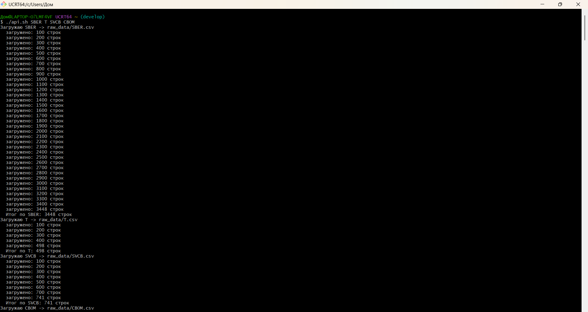
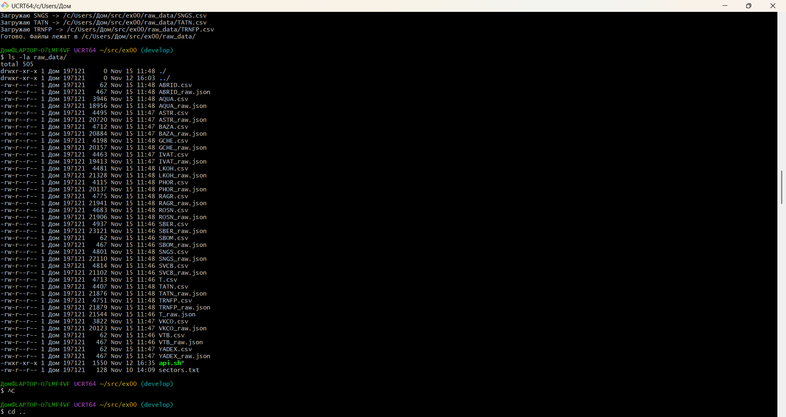
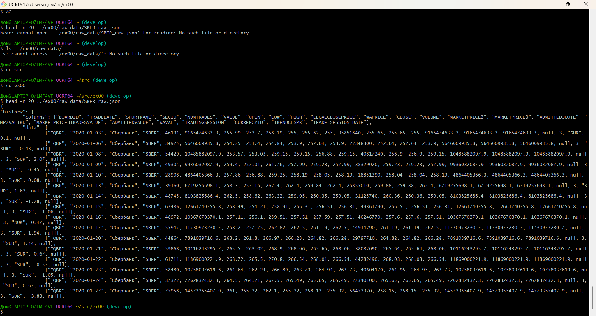

## Задание 1. Сбор данных с API Московской биржи

### Выбор секторов и котировок

Для анализа выбраны 4 сектора рынка, по 5 акций в каждом:

| Сектор | Тикер | Компания |
|---|---|---|
| Банковский сектор | SBER | Сбербанк |
| Банковский сектор | VTBR | ВТБ |
| Банковский сектор | SVCB | Совкомбанк |
| Банковский сектор | CBOM | Совкомбанк |
| Банковский сектор | ROSB | Росбанк |
| IT | YDEX | Яндекс |
| IT | VKCO | VK |
| IT | T | Т-Технологии |
| IT | BAZA | ГК Базис |
| IT | IVAT | IVA Technologies |
| Нефтяная отрасль | LKOH | Лукойл |
| Нефтяная отрасль | ROSN | Роснефть |
| Нефтяная отрасль | SNGS | Сургутнефтегаз |
| Нефтяная отрасль | TATN | Татнефть |
| Нефтяная отрасль | TRNFP | Транснефть |
| Агропромышленный комплекс | AQUA | Инарктика |
| Агропромышленный комплекс | RAGR | Русагро |
| Агропромышленный комплекс | GCHE | Черкизово |
| Агропромышленный комплекс | PHOR | ФосАгро |
| Агропромышленный комплекс | ABRD | Абрау-Дюрсо |

Список тикеров сохранён в `src/ex00/sectors.txt`.

> 
### Что такое API

API (Application Programming Interface) — программный интерфейс, который
позволяет обмениваться данными между приложениями без парсинга HTML-страниц.
Вместо «глазами читать сайт» скрипт отправляет HTTP-запрос к специальному
адресу и получает структурированный ответ (в нашем случае — JSON), который
удобно обрабатывать автоматически.

### Документация API Московской биржи

Мосбиржа предоставляет открытый API ISS (Interactive Systems Server):
https://www.moex.com/a2193 (документация) — по нему доступны исторические
данные о торгах без регистрации и ключей.

Использованный метод — история торгов по бумаге на основном режиме:

```
https://iss.moex.com/iss/history/engines/stock/markets/shares/boards/TQBR/securities/<TICKER>.json?from=2020-01-01
```

Параметры запроса:

- `<TICKER>` — тикер бумаги (например, `SBER`);
- `from` — дата начала периода;
- ответ содержит блок `history` с полями `columns` (названия колонок)
  и `data` (страницы данных, при необходимости листаются через `start`).

В ответе нас интересуют поля: `TRADEDATE`, `OPEN`, `LOW`, `HIGH`, `CLOSE`,
`VOLUME` — дата торгов, цены открытия/минимум/максимум/закрытия и объём.

### Реализация скрипта

Скрипт `src/ex00/api.sh`:

- принимает список тикеров аргументами командной строки: `./api.sh SBER TATN ...`;
- для каждого тикера выполняет `curl`-запрос к ISS API;
- сохраняет сырой ответ в `raw_data/<TICKER>_raw.json`;
- из ответа достаёт блок `history` (jq) и кладёт данные
  в `raw_data/<TICKER>.json` — по одному файлу на акцию;
- проверяет, что тикер существует (пустой ответ = ошибка).





### Результат

Для каждой из 20 акций получен файл с историей торгов с 2020 года.
Пример структуры данных (SBER):

```
BOARDID, TRADEDATE, SHORTNAME, SECID, ..., OPEN, LOW, HIGH, ..., CLOSE, VOLUME, ...
```

