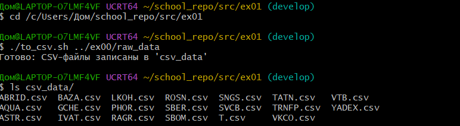
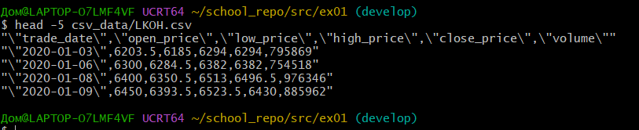

## Задание ex01: JSON to CSV

## Описание

Данные, собранные в задании ex00, хранятся в формате `.json`. Для анализа
данных удобнее табличный формат, поэтому в этом задании реализована
конвертация JSON-файлов в CSV.

## Структура решения

- `to_csv.sh` — исполняемый bash-скрипт;
- `filter.jq` — фильтр для преобразования JSON в CSV;
- `csv_data/` — директория с результатами (у каждой акции свой файл).

## Запуск

Скрипт принимает на вход директорию с `.json`-файлами из прошлого задания:

    ./to_csv.sh ../ex00/raw_data

## Фильтр filter.jq

Фильтрация вынесена в отдельный файл. Фильтр находит в JSON блок с полями
`columns` и `data`, первую строку CSV записывает как заголовок, остальные
строки выводит через `@csv`:

    . as $root
    | [ $root | objects | select(has("columns") and has("data")) ][0] as $block
    | ($block.columns | @csv),
      ($block.data[] | @csv)

## Результат

В директории `csv_data/` создаются CSV-файлы — по одному на каждую акцию.

