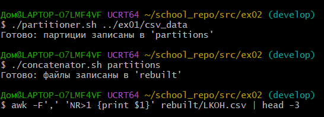
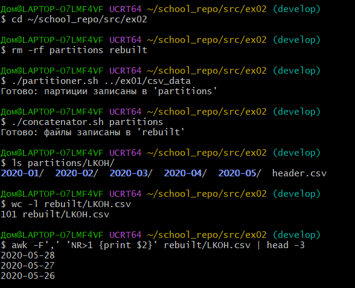
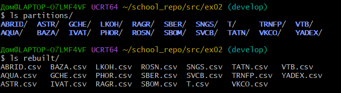

# ex02. Partitioning and Sorting

## Описание
Скрипты для разбиения CSV с котировками на месячные партиции
и последующей пересборки с сортировкой дат по убыванию.

## Структура
- partitioner.sh — режет CSV из ex01 по месяцам в partitions/
- concatenator.sh — собирает партиции обратно в rebuilt/ (даты по убыванию)

## Запуск
chmod +x partitioner.sh concatenator.sh
./partitioner.sh ../ex01/csv_data
./concatenator.sh partitions

## Пример результата
partitions/LKOH/ — header.csv + каталоги 2020-01..2020-05 с data.csv
rebuilt/LKOH.csv — заголовок + все строки, TRADEDATE по убыванию
## Скриншоты

