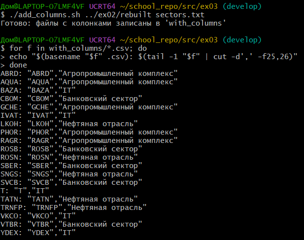

## Задание 4. Добавление колонок TICKER и SECTOR

### Входные данные

Скрипт использует результат `ex02` — готовые CSV-файлы с историей торгов
(`../ex02/rebuilt`), по одному на акцию, отсортированные по дате.

Соответствие тикеров и секторов задаётся в `src/ex03/sectors.txt`.
Всего 4 сектора по 5 тикеров:

| Сектор | Тикеры |
|---|---|
| Банковский сектор | SBER, VTBR, SVCB, CBOM, ROSB |
| IT | YDEX, VKCO, T, BAZA, IVAT |
| Нефтяная отрасль | LKOH, ROSN, SNGS, TATN, TRNFP |
| Агропромышленный комплекс | AQUA, RAGR, GCHE, PHOR, ABRD |

Формат файла — по одному тикеру в строке, тикер и название сектора
разделены символом табуляции:
### Реализация скрипта

Скрипт `src/ex03/add_columns.sh`:

- принимает два аргумента: директорию с CSV-файлами (`../ex02/rebuilt`)
  и путь к файлу соответствий (`sectors.txt`);
- очищает выходную директорию `with_columns`;
- для каждого CSV-файла определяет тикер по имени файла и находит
  его сектор в `sectors.txt`;
- добавляет в каждую строку две колонки: `TICKER` (25-я) и `SECTOR` (26-я),
  значения берутся из `sectors.txt`;
- результат сохраняет в `with_columns/<TICKER>.csv` — по одному файлу на акцию.

### Проверка результата

Состав `with_columns`: 20 файлов, по количеству строк совпадают с
`rebuilt` (например, LKOH — 1742 строки, BAZA — 236).

Пример последних двух колонок (TICKER, SECTOR):

### Результат

Для каждой из 20 акций получен файл с двумя новыми колонками.
Все тикеры из старого списка (SBOM, VTB, YADEX, ABRID, ASTR) отсутствуют,
сектора распределены по группам из `sectors.txt`.